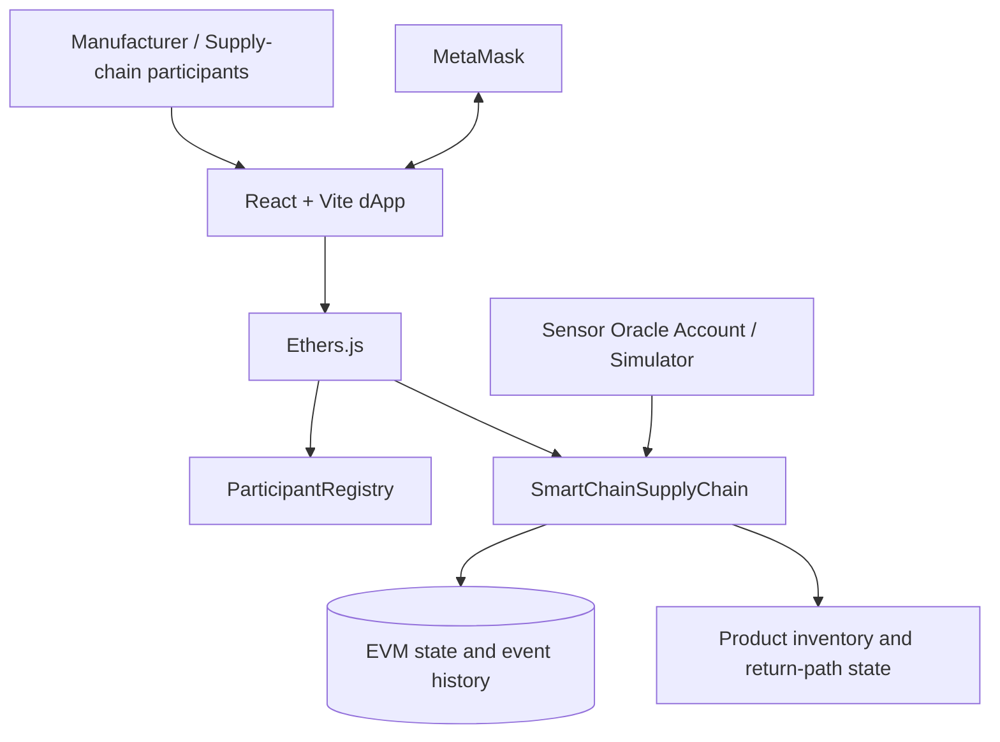
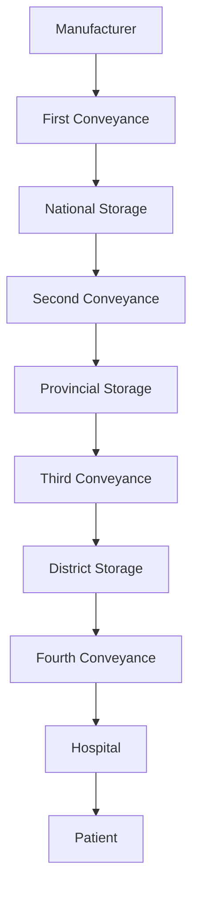
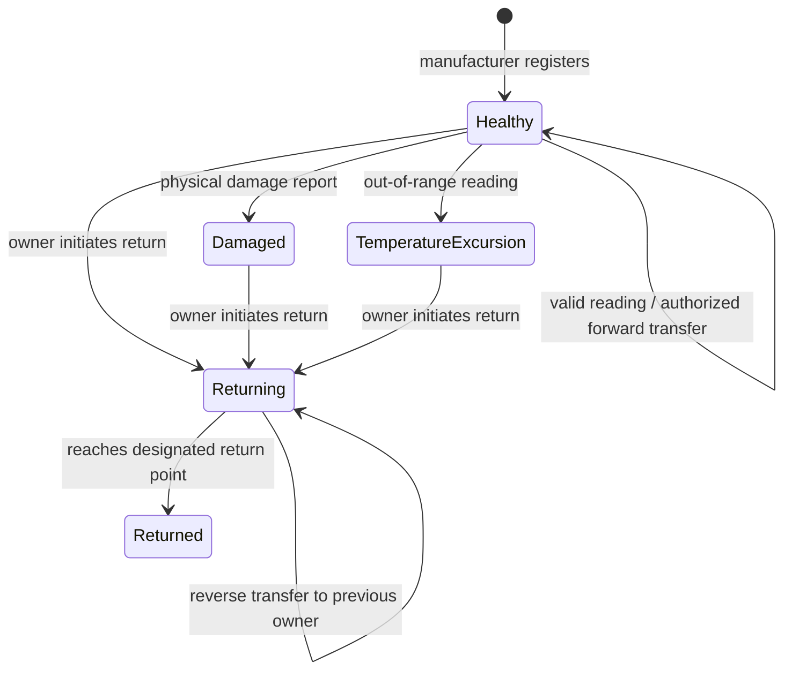

# SmartChain — Blockchain-Based Pharmaceutical Supply Chain Management

SmartChain is a research prototype that applies Ethereum-compatible smart contracts to pharmaceutical supply-chain management. It is based on the paper:

> Eren Yigit and Tamer Dag, “Improving Supply Chain Management Processes Using Smart Contracts in the Ethereum Network Written in Solidity,” *Applied Sciences*, 2024, 14(11), 4738. https://doi.org/10.3390/app14114738

The implementation focuses on the paper's main mechanisms: participant roles and direct connections, manufacturer-only product registration, on-chain inventory and product history, forward transfers, condition monitoring, reverse logistics, and internal wallet accounting.

> **Status:** This repository is a starter implementation. Run the tests locally and deploy it to a disposable development chain before using it for a demonstration. It is not audited and is not suitable for real medicines, money, patient information, or production supply chains.

## What is implemented

- **ParticipantRegistry** — ordered supply-chain roles, participant onboarding by an existing participant, explicit parent-child links, and participant removal checks.
- **SmartChainSupplyChain** — product registration, inventory ownership, on-chain history, forward transfers, reverse transfers, sensor condition reports and internal wallet balances.
- **Cold-chain rules** — temperature and humidity thresholds are stored per product. An oracle report flags a product when a reading exceeds its configured limits or reports physical damage. Unhealthy status is sticky; a later normal reading does not silently clear it.
- **Return flow** — reverse transfers must follow the exact prior-owner path. A product stops at its configured return location and is marked `Returned`. Participants referenced by an unfinished product route cannot be removed even after custody has moved on.
- **Wallet accounting** — users deposit ETH into an internal balance; successful transfers debit the sender's configured fee and credit the receiver; withdrawals use a checks-effects-interactions pattern and reentrancy guard.
- **React/Vite interface** — MetaMask connection, participant onboarding, inventory, product lookup, QR reference generation, operations and sensor reporting. The ethers v6 contract helper accepts either a Provider or Signer and performs chain/bytecode checks before calls.
- **Sensor simulator** — sends sample readings from a configured oracle account to a local contract.

## Research-paper mapping

| Research-paper concept | SmartChain implementation |
|---|---|
| Participant details and roles | `ParticipantRegistry.sol` and `SupplyChainTypes.sol` |
| Manufacturer creates products | `registerProduct()` |
| Participant-to-participant relationships | `addParticipant()` and `isDirectConnection` |
| Inventory and product timeline | `getInventoryOf()`, `getProductHistory()` |
| Forward product ownership changes | `transferProduct()` |
| Reverse logistics | `setProductForReturn()` and `returnTransfer()` |
| Sensor/condition data | `reportSensorData()` restricted to `sensorOracle` |
| Fees and wallets | `deposit()`, `withdraw()`, `walletBalance` |
| Flow and edge-case validation | `test/SmartChainSupplyChain.test.js` |

## Architecture



### Contract responsibilities

- `SupplyChainTypes.sol`: shared role, product status, action and data structures.
- `ParticipantRegistry.sol`: participant profile, role ordering and direct relationship validation.
- `SmartChainSupplyChain.sol`: product lifecycle, sensor reports, transfer checks, return stack and wallet accounting.

### Participant route



The registry allows a participant to onboard the immediately following role. The relation is explicit on-chain; a product cannot skip a checkpoint.

### Product lifecycle



The contract uses the `isReturning` flag plus the `ProductStatus` enum; `Returning` in the diagram is a workflow state, not a separate enum member.

## Stack

- Solidity `0.8.24`
- Hardhat `2.x` and ethers `6.x`
- React `18`, Vite `5`, ethers `6`
- MetaMask injected provider
- Optional Sepolia testnet deployment
- Local sensor simulator using the configured oracle wallet

## Prerequisites

- Node.js 20 or newer (Node 22 recommended)
- npm
- MetaMask browser extension for the UI

## Run locally (Windows PowerShell)

Open a terminal in the repository root:

```powershell
npm install
npm run compile
npm test
```

In Terminal 1, start a local Hardhat node and leave it running:

```powershell
npm run node
```

In Terminal 2, deploy the contracts, seed the demonstration route, and run the local deployment checks:

```powershell
npm run setup:local
```

`setup:local` runs `deploy:local`, `seed:local`, and `check:local` in order. It does not start the node; Terminal 1 must already be serving `http://127.0.0.1:8545`.

The deployment script writes:

- `deployments/localhost.json`
- `frontend/src/deployment.json`
- `frontend/src/abi/ParticipantRegistry.json`
- `frontend/src/abi/SmartChainSupplyChain.json`
- `results/demo-accounts.json` (generated by `npm run seed:local`)

Copy `frontend/.env.example` to `frontend/.env.local` only if you need to change the read-only RPC URL. From the repository root, install and run the frontend:

```powershell
npm run frontend:install
npm run frontend:dev
```

Open the local Vite URL printed in the terminal. In MetaMask, add or select the Hardhat local network:

- Network name: Hardhat Local
- RPC URL: `http://127.0.0.1:8545`
- Chain ID: `31337`
- Currency symbol: `ETH`

Import a **local Hardhat test account only** into MetaMask. Never use a real wallet private key for local development. The first Hardhat account is the deployment administrator and is the default Manufacturer. For your own existing MetaMask wallet, use `npm run setup:local:existing` as described below; that configured address becomes the Manufacturer.

### Suggested demo sequence

1. Use `results/demo-accounts.json` to map the demo role addresses. With the default setup, connect Hardhat Account 0; with the existing-wallet setup, connect the configured `manufacturer` address.
2. Add a First Conveyance participant using a second local account.
3. Connect that account and add National Storage using a third local account.
4. Repeat the ordered role onboarding until Hospital and Patient are present.
5. Switch back to the Manufacturer, register a test vaccine product and deposit internal wallet funds.
6. Transfer the product one checkpoint at a time. Each receiver receives the transfer fee and can use it to pay for the next transfer.
7. Look up the Product ID and inspect its on-chain event history / QR code.
8. Connect the configured oracle account and submit a normal sensor reading or run the simulator.
9. Initiate a return and execute reverse transfers through each prior owner until the return location is reached.

## Sensor simulation

The local deploy script uses the deployer as the oracle unless `SENSOR_ORACLE_ADDRESS` is set. For a local demonstration, the oracle private key must correspond to that address.

First create `.env` from `.env.example`, then set:

```dotenv
RPC_URL=http://127.0.0.1:8545
SENSOR_PRIVATE_KEY=YOUR_LOCAL_ORACLE_PRIVATE_KEY
PRODUCT_ID=0xYOUR_64_HEX_CHARACTER_PRODUCT_ID
SENSOR_INTERVAL_MS=12000
```

Then run from the repository root:

```powershell
npm run sensor:simulate
```

To submit a simulated out-of-range reading once per interval (use a disposable test product because the unhealthy state is sticky):

```powershell
npm run sensor:simulate -- --alert
```

This is an account-authorized oracle simulation. It is **not** a Chainlink integration and it does not prove that a physical sensor measured the submitted value. A real ESP32 / DHT sensor and a separately operated oracle bridge are future hardware integration work.

## Sepolia deployment

1. Copy `.env.example` to `.env`.
2. Set `SEPOLIA_RPC_URL` and `PRIVATE_KEY` for a disposable testnet deployer. Keep `.env` out of Git.
3. Make sure the deployer has Sepolia test ETH.
4. Run:

```powershell
npm run compile
npm test
npm run deploy:sepolia
```

Only deploy to a public network after checking the contract source, configuration, and intended wallet. The deployment script creates a new deployment manifest and exports ABIs for the frontend. Do not put real product, patient, personal, or commercially sensitive data on a public chain.

## Local-development troubleshooting (Windows)

- **`EADDRINUSE` on port 8545:** a node is already using the local RPC port. Check the other terminals first. If the existing Hardhat node is running, leave it open and run `npm run setup:local` in another terminal. To identify the process, use `netstat -ano | findstr :8545`, then `tasklist | findstr <PID>`. Stop it only if it is an old unwanted Hardhat process. Restarting the node erases its in-memory chain state; deploy and seed again afterward.
- **`Missing script: check:local`:** the terminal is in an older project folder. Run `pwd` and `npm run` and check that the current root `package.json` lists `check:local` and `setup:local`. Extract the single current SmartChain ZIP into a new folder and open that extracted root in VS Code; do not copy only the frontend folder.
- **MetaMask says chain 11155111:** that is Sepolia. The default local project expects Hardhat Local, chain ID `31337`, RPC `http://127.0.0.1:8545`, currency `ETH`. In MetaMask, switch to Hardhat Local and use a disposable local Hardhat account.
- **Wallet connects but product registration is unavailable:** compare the connected full MetaMask address with `manufacturer` in `frontend/src/deployment.json`. For an existing wallet, set the full address in the project-root `.env`, run `npm run setup:local:existing`, restart Vite, and run `npm run check:local:existing`. For the default setup, connect Hardhat Account 0. Other participant roles cannot register products.
- **`No contract bytecode` or ABI missing:** confirm the local node is still running, then run `npm run setup:local` from the project root. Do not use contract addresses from an older local node.
- **Transaction says insufficient wallet balance:** first deposit ETH into the SmartChain internal wallet in the Operations page. This internal balance is separate from MetaMask's gas balance.

## Testing

```powershell
npm test
npm run test:gas
npm run benchmark:local
```

Tests cover participant role order, unauthorized onboarding, product validation, manufacturer-only registration, inventory, allowed and disallowed transfers, fee accounting, oracle authorization, threshold violations, sticky unhealthy status, product history, reverse routing, return checkpoint enforcement, participant removal and wallet withdrawals.

The authored suite contains 30 test cases. Execution is not claimed until `npm test` completes successfully in your local environment. The test suite is a baseline, not a substitute for fuzzing, invariant testing, static analysis or an independent security audit. Record the actual number of passing tests from your own run rather than claiming a target count.

The project report outline and a step-by-step walkthrough are in `docs/PROJECT_REPORT_OUTLINE.md` and `docs/DEMO_SCRIPT.md`.

## Known limitations and future work

1. **Oracle trust:** `sensorOracle` is a trusted reporting address. A compromised or dishonest oracle can submit false readings. A production design needs authenticated devices, multiple data sources, freshness checks and a carefully designed oracle/decentralized oracle layer.
2. **Public data:** participant names and contact emails are stored in public contract state in this prototype to mirror the paper's participant data model. Use synthetic details only. A production system should minimize or hash personal data.
3. **On-chain cost:** product metadata and history use on-chain storage for traceability. This can be expensive on a public L1. A separate hybrid-storage experiment can place large documents and sensor evidence on IPFS while keeping content hashes and state transitions on-chain.
4. **Access model:** the role sequence is a simplified linear pharmaceutical route. Real supply chains may branch, merge, split batches or include multiple vendors at the same stage.
5. **IoT hardware:** the current simulator submits readings from a wallet. Physical ESP32/DHT integration and a production oracle adapter are not yet implemented.
6. **Frontend scope:** this is a research demo interface, not a production UI. QR codes encode a product lookup URL; read-only lookups use `VITE_RPC_URL` and do not require a connected wallet. A public-hosted verifier and production RPC failover are future work.
7. **No audit:** no professional smart-contract audit or formal verification has been performed.

## Project status checklist

- [x] Modular Solidity sources and shared data types
- [x] Participant roles and direct links
- [x] On-chain product data, inventory and history
- [x] Forward transfer / return transfer enforcement
- [x] Wallet balance and fee accounting
- [x] Oracle-authorized sensor reports
- [x] Hardhat test suite source
- [x] React / Vite frontend source
- [x] Local deployment script and ABI export
- [x] Sensor simulator
- [x] Architecture and setup documentation
- [ ] Local npm install, compile and test run on the target machine
- [ ] MetaMask end-to-end demo
- [ ] Sepolia deployment and explorer verification
- [ ] Physical sensor and production oracle integration
- [ ] Security review / audit

## License

MIT for this implementation. The research article is cited above; review its CC BY 4.0 terms for reuse of paper text and figures. This repository does not include copied paper figures.


## Why "not registered" appears and where product registration is shown

The Manufacturer is created by `ParticipantRegistry` at deployment. In the default local setup, it is the deployer. In the existing-wallet setup, it is the public address configured by `LOCAL_MANUFACTURER_ADDRESS`; this address is written to the `manufacturer` field in `frontend/src/deployment.json`. The contract administrator is stored separately as `deployer`.

A connected MetaMask account is not automatically made a participant. To use one of your own existing MetaMask accounts as Manufacturer:

1. Copy the full public address from MetaMask (not the shortened display).
2. In the project root, copy `.env.example` to `.env` and set `LOCAL_MANUFACTURER_ADDRESS=0x...`.
3. Start/keep the Hardhat node running on `http://127.0.0.1:8545`.
4. Run `npm run setup:local:existing` and wait for both `ALL LOCAL DEPLOYMENT CHECKS PASSED` and `EXISTING METAMASK MANUFACTURER CHECKS PASSED`.
5. Stop any old Vite process with Ctrl+C, restart `npm run frontend:dev`, switch MetaMask to Hardhat Local (chain ID `31337`), and connect the exact address from `.env`.
6. Open **My inventory**. The **Register a new product** form should appear for the Manufacturer.

The strict setup command fails if the environment address is absent or if the address in `.env`, the deployment manifest, and the on-chain Manufacturer record do not match. It does not silently fall back to Account #0.

For the default setup without a custom address, run `npm run setup:local` and connect Hardhat Account #0. Other participant roles must be onboarded by their immediate parent participant, in the prescribed role order.

## MetaMask troubleshooting

- If MetaMask is connected but the page says `Wrong network`, the wallet account is authorized but the selected chain does not match `frontend/src/deployment.json`.
- The default local setup expects chain ID `31337` and RPC `http://127.0.0.1:8545`.
- Start `npm run node`, deploy with `npm run deploy:local`, then use the app's **Switch network** action (or select/add Hardhat Local in MetaMask).
- If the wallet is on the correct chain but contract calls fail, confirm that `frontend/src/deployment.json` contains non-zero contract addresses and that deployment generated the ABI JSON files in `frontend/src/abi/`.
- The frontend now keeps the wallet account visible even when the selected chain is wrong and reports the network mismatch separately.


## Existing MetaMask Manufacturer setup

This configuration is only for local Hardhat chain ID `31337`, not Sepolia or mainnet.

The strict existing-wallet workflow is:

```bash
cp .env.example .env
# Edit .env and set LOCAL_MANUFACTURER_ADDRESS to the full MetaMask public address.
npm run setup:local:existing
npm run check:local:existing
```

The strict setup refuses to continue if the address is missing or malformed. The deployment manifest keeps `deployer` (contract administrator) and `manufacturer` (supply-chain participant) separate. The frontend authorizes product registration by the on-chain Manufacturer role, not by the deployment admin address. Stop and restart any old Vite process after setup so it reloads the new deployment JSON.
